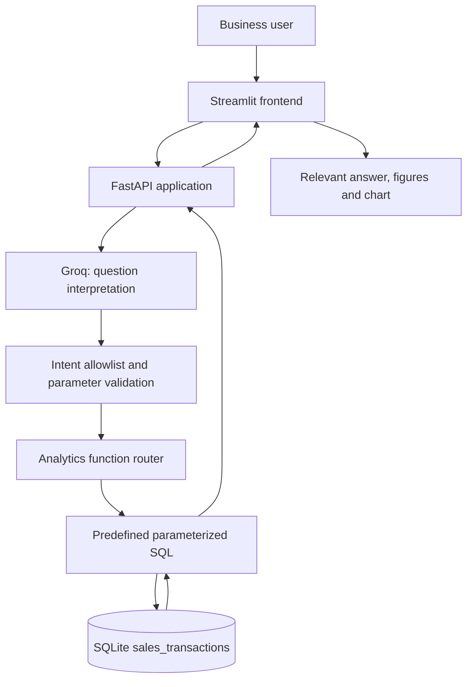

# SalesIQ — Architecture

## Overview
SalesIQ uses LLM-based intent classification with deterministic Python analytics and predefined SQL. The model interprets the question; it does not calculate revenue or execute generated SQL.

## Architecture diagram

## Components
- `backend/data_inspection.py`: inspects CSV data quality.
- `backend/data_loader.py`: validates and imports CSV data.
- `backend/database.py`: manages SQLite connection and schema.
- `backend/ai_service.py`: calls Groq and interprets questions.
- `backend/analytics.py`: contains deterministic analytics functions.
- `backend/main.py`: exposes FastAPI endpoints and routes approved intents.
- `frontend/app.py`: accepts questions and displays the relevant answer and visualization.

## Supported intents
`total_revenue`, `product_revenue`, `monthly_revenue`, `region_revenue`, `compare_monthly_revenue`, and `unsupported`.

## Request lifecycle
1. User enters a question in Streamlit.
2. Streamlit sends JSON to `POST /ask`.
3. FastAPI validates the request and calls the Groq interpretation service.
4. The returned intent and parameters are validated.
5. The backend routes an allowed intent to its analytics function.
6. The function executes predefined SQL against SQLite.
7. FastAPI returns structured result data.
8. Streamlit displays the answer and relevant supporting figures/chart.

## Safety and correctness
- The LLM does not generate SQL for execution.
- Only allowlisted intents are routed.
- Comparison month parameters are validated.
- SQL is predefined and parameterized where applicable.
- Unsupported questions are rejected.
- There is no natural-language route for destructive database operations.

## Revenue policy
Net revenue is `quantity × unit_price − discount_amount`. Only rows marked `revenue_eligible = 1` contribute. Returned transactions and transactions with missing unit prices are retained but excluded. A completed zero-quantity transaction remains eligible and contributes zero revenue.
